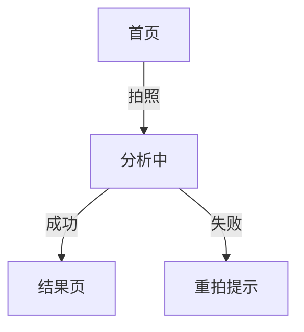

# 说明文档 — 影响面与业务流程

> **依据**：`stories.md` 里已由用户审核过的 U 编号（改了故事就回来改这份）。
> **用途**：告诉后面的验收卡、规格、计划、任务"要动哪些页面 / 功能 / 数据，这个场景怎么走完"。
> **不写**：技术选型、框架、库、SQL、字段类型——那些是 `plan.md` 的事。

## 0. 怎么用

| 步骤 | 谁做 | 做什么 |
|---|---|---|
| ① 读 | AI | 只认 `stories.md` 当前内容，不认自己起草时的记忆 |
| ② 拆 | AI | 每条 U 拆成：页面 / 功能 / 数据 / 业务流程 四块 |
| ③ 审 | 用户 | 直接改本文件；页面名、功能边界、数据口径以你的改为准 |
| ④ 接 | AI | 用追溯表把 `U# → F# → RAC` 串起来，进 `accept` |

**判断标准**：一条 U 拆完，你看完这四块能说出"这个功能要做几个页面、动几张表、流程几步"——就合格。

## 1. 影响总览

| 故事 | 新增页面 | 改动页面 | 功能点 | 数据变更 | 流程步骤 | 风险 |
|---|---|---|---|---|---|---|
| U1 [王大姐买醋] | [1] | [1] | [F1,F2] | [配料表:新增] | [5] | [低] |
| U2 | | | | | | |

---

## 2. U1 [王大姐买醋]

### 2.1 影响的页面

| # | 页面（用户叫法） | 新增/改动/复用 | 入口 | 关键状态 | 备注 |
|---|---|---|---|---|---|
| P1 | [首页] | 改动 | [小程序启动] | [默认/已选品类] | [加一个入口按钮] |
| P2 | [配料表分析页] | 新增 | [首页拍照 / 相册] | [加载/成功/识别失败/网络错误] | |

- 共用组件 / 权限边界：[哪些复用、哪些角色看不到]
- 跳转示意：[首页] →点击拍照→ [配料表分析页] →返回→ [首页]

### 2.2 影响的功能

| # | 功能点 | 现状 | 目标 | 归属模块 |
|---|---|---|---|---|
| F1 | [拍照识别配料表] | [无] | [一次拍照出结论] | [配料模块] |
| F2 | [逐条解释配料] | [无] | [每条给用途+标准] | [配料模块] |

### 2.3 影响的数据

| # | 实体 / 字段 / 接口 | 读/写 | 变更类型 | 兼容 / 迁移 |
|---|---|---|---|---|
| D1 | [配料表识别结果] | 写 | 新增 | [无历史数据] |
| D2 | [标准库] | 读 | 复用 | [需补 30 条] |

### 2.4 整体业务流程（本场景端到端）

```text
1. 王大姐打开小程序 → 首页（P1）看到「拍一拍，帮你买」
2. 点按钮 → 相机 → 拍配料表
3. 上传图片 → 分析（P2 加载态，最多 8s）
4. 出结果：顶部结论（买/不买 + 原因）+ 下方逐条解释
5. 看完 → 返回首页（保留上次品类）
```

- 分支 A：[识别不出主体] → 提示重拍，不进入结果页
- 分支 B：[无网络] → 提示"网络异常，重试"，保留图片
- 分支 C：[散装无标准号] → 只出配料解释，标准卡显示"未收录"
- 业务硬规则：[没有结论不许显示结果表]（结论先出，表后出）
- 可选 mermaid：



> 编号步骤和 mermaid 不一致时，**以编号步骤为准**。

### 2.5 追溯

| 流程节点 | 页面 | 功能 | 数据 | 对应 RAC |
|---|---|---|---|---|
| 3 上传分析 | P2 | F1 | D1 | RAC-002 |
| 4 逐条解释 | P2 | F2 | D2 | RAC-003 |

---

## 3. U2 [谁 + 干什么]

（同上：2.1 页面 / 2.2 功能 / 2.3 数据 / 2.4 流程 / 2.5 追溯）

---

## 4. 依赖、风险与待确认

| # | 类型 | 内容 | 影响 | 处置 |
|---|---|---|---|---|
| R1 | 待确认 | [散装商品无条码怎么办] | [可能拆出 P3 手动录入页] | [问用户] |
| R2 | 风险 | [识别服务 8s 超时] | [体验] | [plan 阶段定降级方案] |

## 5. 变更记录

| 日期 | 变更 | 触发 |
|---|---|---|
| [YYYY-MM-DD] | [新建，覆盖 U1–U3] | [stories 审核通过] |
